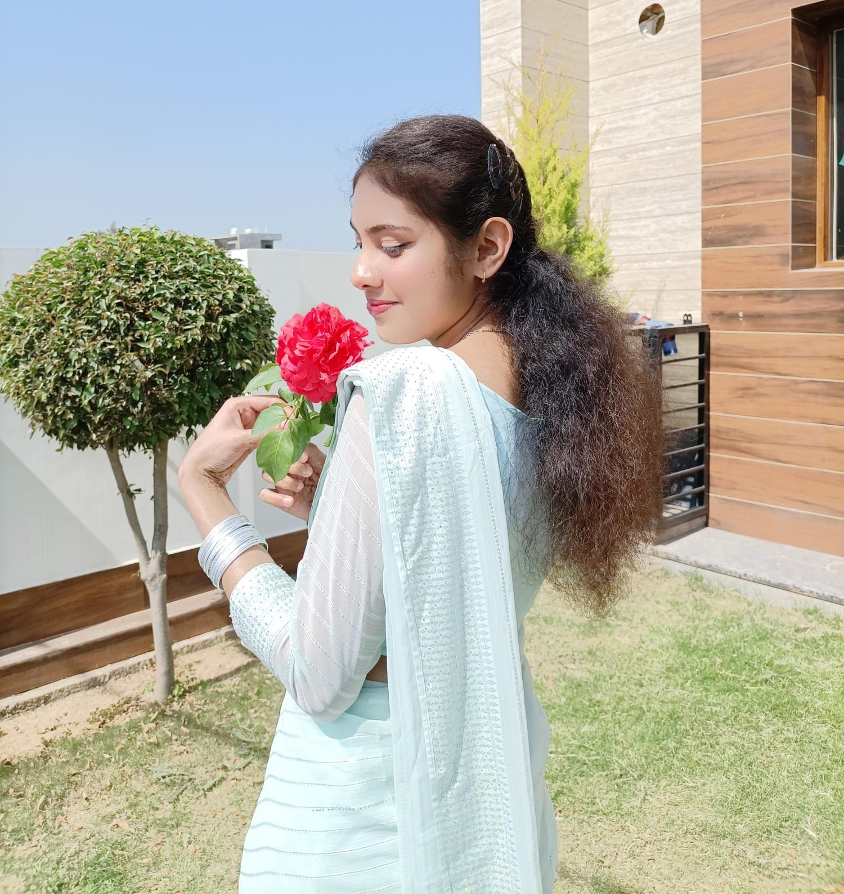

# Ronak Khan | Developer Portfolio

<p align="center">
  
</p>

<h3 align="center">Building Thoughtful Digital Experiences</h3>

<p align="center">
  A personal developer portfolio showcasing my technical skills, featured projects, certifications, and journey in software development.
</p>

<p align="center">
  <a href="https://github.com/Devloper-Ronak">
    
  </a>
  <a href="https://www.linkedin.com/in/ronak-khan-587ba2328/">
    
  </a>
</p>

---

## About the Portfolio

Welcome to my personal developer portfolio!

I'm **Ronak Khan**, a Computer Science and Engineering student at the Central University of Jammu, interested in building practical software solutions through **Full-Stack Web Development and Artificial Intelligence/Machine Learning**.

This portfolio brings together my development journey, technical skills, projects, certifications, and activities in one place. It reflects my focus on continuous learning, problem-solving, and creating clean, responsive, user-friendly web experiences.

## Highlights

- **Professional Introduction** — Learn about my interests and development journey.
- **Technical Skills** — Explore the technologies and tools I work with.
- **Featured Projects** — Discover applications I've built and explored.
- **Certifications & Achievements** — View my learning milestones.
- **Activities & Interests** — Get to know my interests beyond coding.
- **Contact & Resume** — Connect with me and explore my professional profile.

## Featured Projects

### 1. BuildForge AI
An AI-powered project blueprint generator designed to help turn project ideas into structured development plans.

**Focus:** AI integration, web development, project planning, and application architecture.

### 2. HireMind AI
An AI-assisted resume screening project focused on resume analysis, ATS compatibility, skill-gap identification, and actionable feedback.

**Focus:** Full-stack development, AI integration, document processing, and recruitment workflows.

### 3. Dating Web Application
A web application project focused on building an engaging user experience for a dating platform.

**Focus:** Application logic, interface design, and software development fundamentals.

### 4. Blogging Platform
A web development project centered on publishing and presenting written content through a structured interface.

**Focus:** Content organization, user experience, and web application development.

> Explore the individual repositories on my GitHub profile for available source code and project details.

## Tech Stack

### Frontend


### Programming Languages


### Tools & Technologies


*My technology stack continues to evolve as I learn, build, and improve through hands-on projects.*

## Built With

This portfolio is built using:

- **HTML5** for semantic page structure.
- **CSS3** for responsive layouts, styling, and visual presentation.
- **JavaScript** for interactive functionality.
- **Git and GitHub** for version control and source-code hosting.

## Run Locally

You can run this portfolio on your computer in a few simple steps.

**1. Clone the repository**

```bash
git clone https://github.com/Devloper-Ronak/ronak-portfolio.git
```

**2. Open the project folder**

```bash
cd ronak-portfolio
```

**3. Launch the website**

Open `index.html` in your browser, or use the **Live Server** extension in Visual Studio Code for a convenient local preview.

No backend server or package installation is required for the basic static portfolio.

## Project Structure

```text
ronak-portfolio/
├── index.html
├── assests/
│   ├── documents/
│   │   └── Ronak Resume.pdf
│   └── images/
│       └── Ronak.jpg
├── css/
│   ├── style.css
│   ├── hero.css
│   ├── about.css
│   ├── skills.css
│   ├── projects.css
│   ├── achievements.css
│   ├── certifications.css
│   ├── activities.css
│   └── contact.css
├── js/
├── pages/
└── README.md
```

*The structure above reflects the current project organization; update it if your folders or filenames change.*

## Design Goals

- Clean and professional presentation.
- Responsive layout across different screen sizes.
- Consistent typography, spacing, and visual hierarchy.
- A cohesive pastel-inspired color palette.
- Easy navigation between portfolio sections.
- Clear presentation of projects, skills, and contact information.

## Current Focus

I'm continuing to strengthen my foundations in software development while building practical projects and exploring AI-powered applications.

My areas of interest include:

- Full-Stack Web Development
- Artificial Intelligence and Machine Learning
- Problem-Solving and Software Engineering
- Building useful, user-focused applications

## Connect With Me

I'm open to connecting with developers, learning from experienced professionals, collaborating on meaningful projects, and exploring suitable internship opportunities.

<p>
  <a href="https://github.com/Devloper-Ronak">GitHub</a> •
  <a href="https://www.linkedin.com/in/ronak-khan-587ba2328/">LinkedIn</a> •
  <a href="mailto:ronakkhan60966@gmail.com">Email Me</a>
</p>

---

<p align="center">
  <i>Learning continuously. Building thoughtfully. Improving with every project.</i>
</p>

<p align="center">
  Made with care by <strong>Ronak Khan</strong>
</p>
